<div align="center">


# Gym Tracker

**An offline-first strength training log for Android, built with Flutter.**
Plan programs, log sets in a couple of taps, rest with a timer that pings you, and watch your lifts go up.

[](https://github.com/OWNER/gym-tracker/actions/workflows/ci.yml)


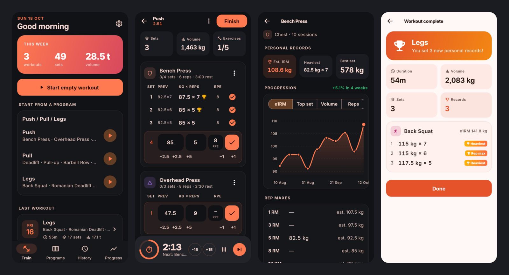

</div>

## Features

**Train**
- **Programs and sessions.** Build programs out of training days (Push, Pull, Legs…) with target sets, reps and rest per exercise. A Push / Pull / Legs starter program is included.
- **Quick set logging.** Weight and reps are prefilled from your last set or from the previous session. Use the one-tap `±2.5 kg`, `+5 kg` and `±1 rep` buttons, pick an RPE from 6 to 10, then tap ✓.
- **Rest timer with notification.** The timer starts as soon as you log a set and uses the rest set for that exercise. It shows a progress ring, `-15/+15 s`, pause and skip. A local notification fires when rest is over, even with the screen off. The timer is driven by wall-clock time, so it stays correct if the app is suspended.

**Progress**
- **Charts per exercise** of estimated 1RM, top set, volume and total reps over time, with the trend over the last 4 weeks.
- **Personal records** for best e1RM, heaviest weight, best set volume and rep maxes. New records are flagged 🏆 while you log and on the workout summary.
- **1RM estimation** uses Epley (Brzycki and Lombardi are also available) with **RPE adjustment**: reps in reserve count as extra reps, so 100 kg × 5 @ RPE 8 is treated as a 7-rep max. A rep-max table suggests working weights.
- **History** grouped by month, with duration, sets, volume and a detailed summary for each workout.

**Everywhere**
- **Fully offline.** Everything lives in a local SQLite database (Drift).
- **Optional Firebase sync** across devices: anonymous auth, Firestore, last-write-wins with tombstones.
- **Light and dark themes** (or follow the system), a custom Material 3 palette and the Inter typeface. Layouts are tested at 360 dp width.
- **Demo data** (Settings → Load demo data) fills in 10 weeks of realistic training so you can explore the charts right away.

<div align="center">
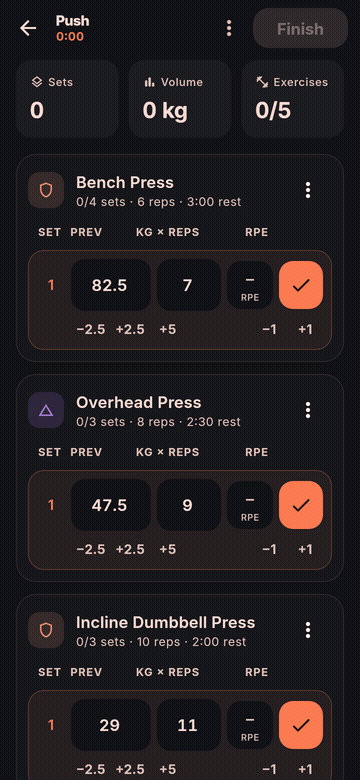
<br/><sub>Logging a set: bump the weight, pick an RPE, tap ✓, and the rest timer starts.</sub>
</div>

## Screenshots

| Home | Active workout | Exercise progress | Progress |
|:---:|:---:|:---:|:---:|
| 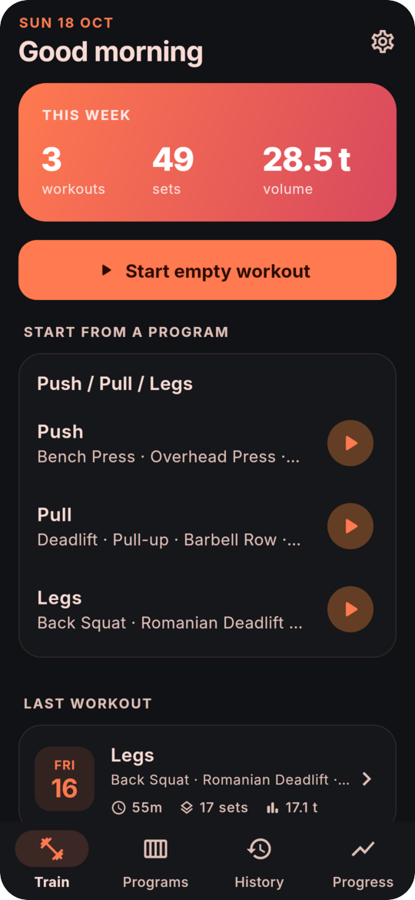 | 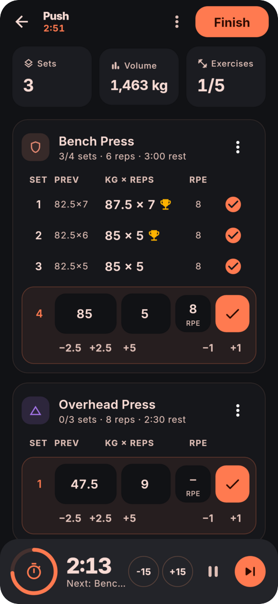 | 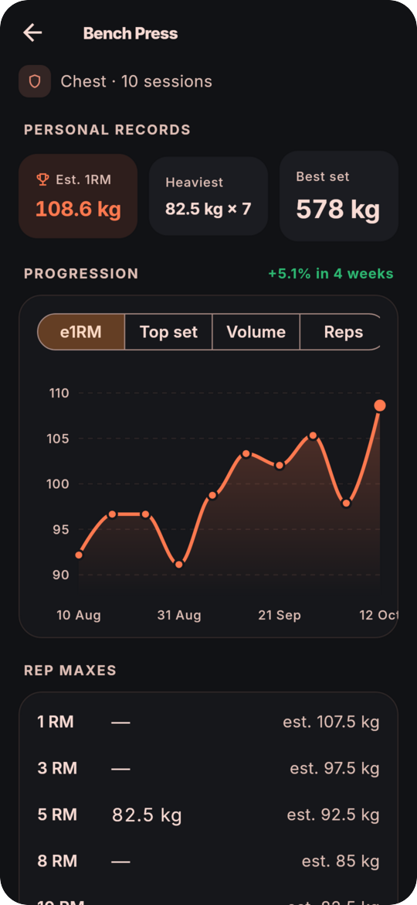 | 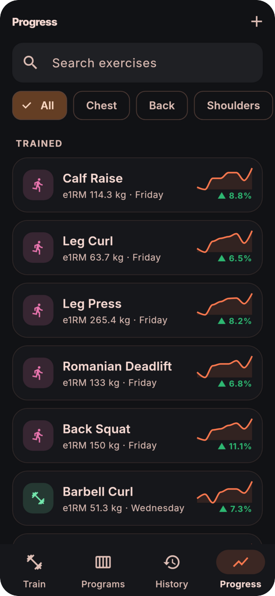 |

| Programs | History | Workout summary | Settings |
|:---:|:---:|:---:|:---:|
| 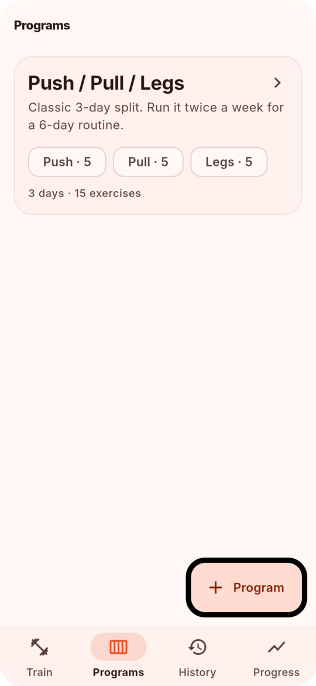 | 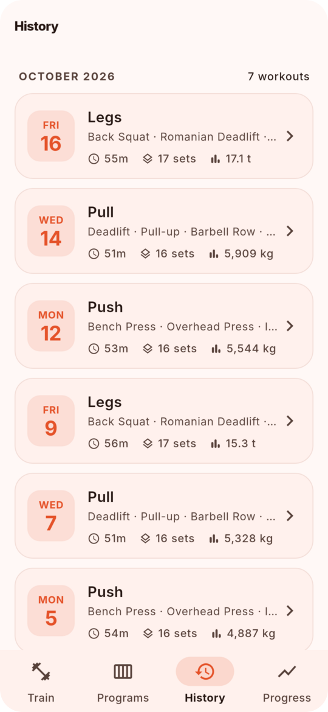 | 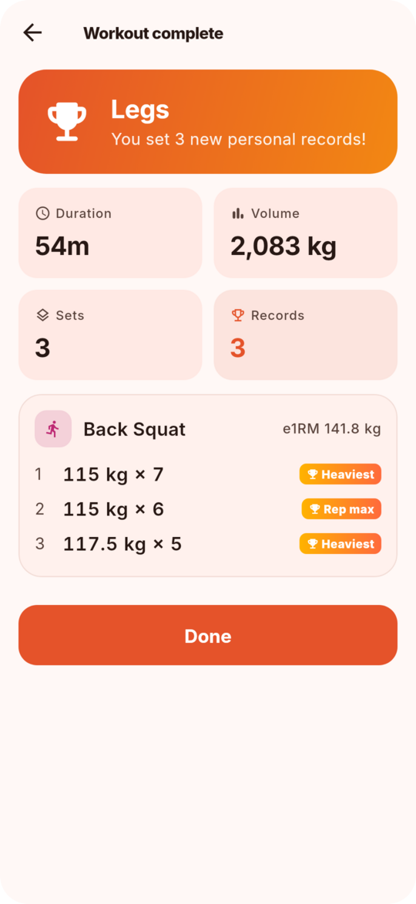 | 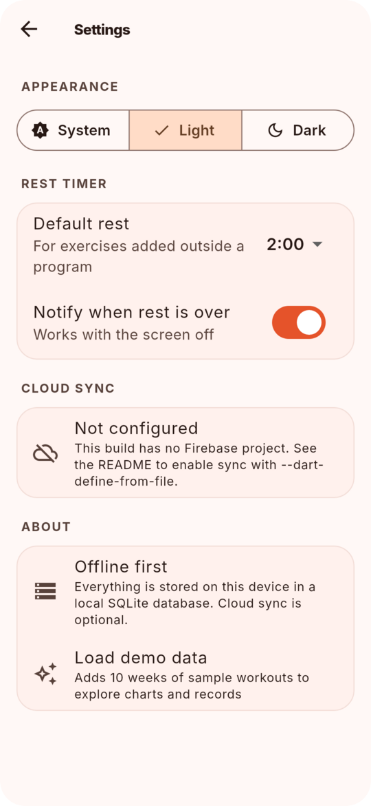 |

> The screenshots and the GIF are rendered from the real app with demo data by [`tool/screenshots.sh`](tool/screenshots.sh), so they always match the code.

## Architecture

The code is organised in layers, with Riverpod for dependency injection and state:

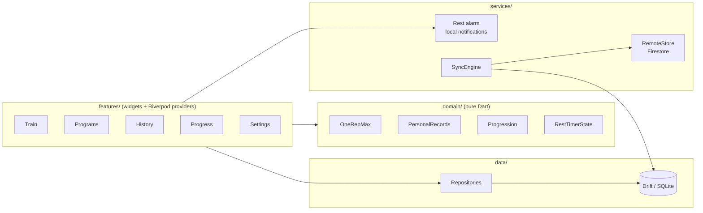

```
lib/
├── core/            theme, formatting, shared widgets, providers (DI)
├── data/
│   ├── db/          Drift tables, database, seed + demo data
│   └── repositories/ exercise, program, workout and settings repositories
├── domain/          1RM formulas, personal records, progression, rest timer (no Flutter)
├── features/        train · workout · programs · history · progress · settings
└── services/        rest notifications, Firebase sync (engine, Firestore store, controller)
```

Main design choices:

- **Domain logic is pure Dart.** e1RM, PR detection, session aggregation and the rest timer state can all be unit-tested without Flutter or a database.
- **Repositories expose streams.** Screens rebuild automatically when data changes: Drift `watch()` queries feed Riverpod `StreamProvider`s.
- **Side effects go through interfaces** (`RestAlarm`, `CloudBackend`, `RemoteStore`, and the clock). Tests swap them for fakes, including a controllable clock.
- **Sync-ready schema.** Rows use client-generated UUIDs plus `updatedAt` and a `deleted` tombstone. Seeded rows have stable IDs and a fixed timestamp, so every device holds the same version.

### Sync

Sync is two-way and uses last-write-wins:

1. **Pull** documents whose server-assigned `syncedAt` is newer than the last cursor, and keep each one only if its `updatedAt` is newer than the local copy.
2. **Push** local rows changed since the previous sync.

The pull cursor is a Firestore **server timestamp**, not a device clock. A change uploaded late by another device is therefore never skipped. Tables are applied parent-first so foreign keys always hold. Each user's data lives under `users/{uid}/…` and is protected by [`firestore.rules`](firestore.rules).

## Getting started

Requirements: Flutter 3.47+ (Dart 3.13), and Android SDK 23+ to run on a device.

```sh
git clone https://github.com/OWNER/gym-tracker.git
cd gym-tracker
flutter pub get
flutter run            # on an Android device or emulator
```

The Drift code (`*.g.dart`) is committed. After changing the tables, run:

```sh
dart run build_runner build --delete-conflicting-outputs
```

### Build an APK

```sh
flutter build apk --release --split-per-abi
```

Release builds are signed with `android/key.properties` if that file exists ([format](https://docs.flutter.dev/deployment/android#reference-the-keystore-from-the-app)). Otherwise they fall back to the debug key. CI builds the APKs for every push and attaches them to GitHub releases when you push a `v*` tag.

### Enable cloud sync (optional)

Without configuration the app is 100% local and Settings shows sync as *Not configured*. To turn sync on:

1. Create a Firebase project. Enable **Authentication → Anonymous** and **Cloud Firestore**, and deploy [`firestore.rules`](firestore.rules).
2. Register an Android app with the package name `dev.gymtracker.gym_tracker`.
3. Copy `firebase.example.json` to `firebase.json` (git-ignored) and fill in the values.
4. Build or run with the config:

   ```sh
   flutter run --dart-define-from-file=firebase.json
   ```

5. Turn on **Settings → Cloud sync**. The app also syncs at launch and after each finished workout.

For CI, store the content of `firebase.json` in a `FIREBASE_CONFIG_JSON` repository secret.

## Testing

```sh
flutter analyze
flutter test             # 70 unit + widget tests, ~89% line coverage of lib/
```

| Suite | What it covers |
|---|---|
| `test/domain` | 1RM formulas and RPE adjustment, PR detection, progression and trends, rest timer state, formatting |
| `test/data` | Repositories on an in-memory SQLite database: starting from a program, logging, editing and deleting sets, previous-session hints, finishing, reordering, soft deletes |
| `test/services` | Two simulated devices syncing through an in-memory store (propagation, incremental sync, conflicts, tombstones), the sync controller, and the rest timer controller under `fake_async` |
| `test/widgets` | End-to-end flows: start a program day, log sets, rest timer, finish and see the summary. Also: empty workouts, editing sets, history, progress charts, building a program, theme switching, enabling sync, and the quick-entry row |

Widget tests load the real Inter font (`test/flutter_test_config.dart`), so the layout checks match a real device.

To regenerate the README screenshots and GIF (requires ImageMagick and ffmpeg):

```sh
./tool/screenshots.sh
```

## Tech stack

| | |
|---|---|
| UI | Flutter, Material 3, [fl_chart](https://pub.dev/packages/fl_chart) |
| State / DI | [Riverpod 3](https://riverpod.dev) |
| Local database | [Drift](https://drift.simonbinder.eu) (SQLite) |
| Notifications | [flutter_local_notifications](https://pub.dev/packages/flutter_local_notifications) |
| Sync | Firebase Auth (anonymous) + Cloud Firestore |
| Tests | flutter_test, fake_async, in-memory SQLite |
| CI | GitHub Actions: format, analyze, tests, APK build and release |

## Roadmap

- Pound (lb) units and a plate calculator
- Supersets and drop sets
- Google sign-in to link the anonymous account
- CSV import and export
- Home-screen widget with this week's stats

## License

[MIT](LICENSE). The bundled Inter font is under the [SIL Open Font License](assets/fonts/OFL.txt).
